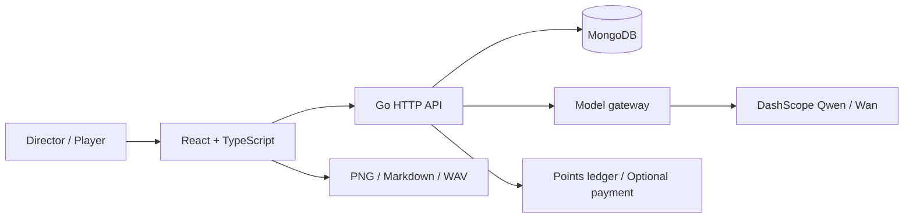

<div align="center">

# EmboPlot

**Give your characters a world. Direct what happens next.**

An open-source AI story theater with an ensemble cast, a director's console, scene images and voice playback.

[](https://github.com/eust-w/EmboPlot/actions/workflows/ci.yml)
[](LICENSE)
[](package.json)
[](backend/go.mod)

[简体中文](README.md) · **English**

[Watch the demo](#watch-the-demo) · [Quick start](#quick-start) · [Architecture](docs/architecture.md) · [Contribute](CONTRIBUTING.md)

</div>


> More than a chat with one character. Build a world, assemble a cast, and intervene as the director, or step into a role yourself. Keep dialogue, scene images and audio references on a shared, persistent timeline.

## Watch the demo

**One-minute introduction (Chinese synthetic narration):** [Horizontal 1080p](https://github.com/eust-w/EmboPlot/releases/download/v0.1.0-alpha.1/EmboPlot-intro-horizontal-1080p.mp4) · [Vertical 1080p](https://github.com/eust-w/EmboPlot/releases/download/v0.1.0-alpha.1/EmboPlot-intro-vertical-1080p.mp4). Actual UI screenshots, a prewritten original story, and AI-assisted art; not live model generation. [Production notes](docs/promo-video.md).

[](https://github.com/eust-w/EmboPlot/releases/download/v0.1.0-alpha.1/emboplot-walkthrough.mp4)

**[Watch / download the full MP4](https://github.com/eust-w/EmboPlot/releases/download/v0.1.0-alpha.1/emboplot-walkthrough.mp4)** · [Sample script](docs/examples/the-last-signal.md) · [Reproduce the recording](docs/showcase.md)

This is an actual local browser recording using an isolated test account, prewritten original fiction and AI-assisted demo illustrations. It is **not** live model output and contains no production user data. The video is silent with English/Chinese captions; it does not validate TTS quality or live payments.

## From an idea to a performance

| Workflow | Implemented capabilities |
| --- | --- |
| **Create a cast and a world** | Draft characters and story settings from prompts; independent personality, memory fields and voices; generate portraits/covers and edit with reference images |
| **Stage a theater** | Choose story, cast, pacing and viewpoint; create, edit, duplicate and delete rooms |
| **Direct the next beat** | Auto-pilot, pause/resume and manual steps; `@` mentions; speak to a character, everyone, yourself or no one |
| **See and hear the scene** | Interleaved narration and dialogue; select multiple lines for an image; sequential voice playback with prefetching |
| **Build a creative library** | Publish or unlist immutable public character/story cards; acquire free copies from the market |
| **Keep your work** | Export a PNG story image, Markdown script or complete WAV audio |
| **Track accounts and usage** | Email/password sessions, uploaded/generated avatars, points and a transaction ledger; optional Hupijiao top-ups |

### Characters with their own context


Each character has a personality, memory field and voice. The next-turn prompt combines the story world, active cast and recent events instead of relying on a single global persona.

### Choose the stage before stepping into it


### A script is more than dialogue

<table>
  <tr>
    <td width="74%"></td>
    <td width="26%"></td>
  </tr>
</table>

Narration sets the scene. Dialogue names its recipient. Images belong to specific beats. Desktop sidebars become a drawer on mobile.

## Quick start

Prerequisites: **Node.js 22.12+, Go 1.24+, MongoDB 7+**. Start your local MongoDB first; the default URI is `mongodb://localhost:27017`. Run these commands from the repository root:

```bash
git clone https://github.com/eust-w/EmboPlot.git
cd EmboPlot
npm ci
cp .env.example .env
openssl rand -hex 32
```

Set `AUTH_JWT_SECRET` in `.env` to that generated value. Adjust the MongoDB URI if needed, then start two terminals:

```bash
# Terminal 1: Go API, default :8080
npm run backend:dev
```

```bash
# Terminal 2: frontend, default :3000
npm run dev -- --host 127.0.0.1
```

Open **[localhost:3000](http://localhost:3000)** and register your own account. No production database or shared default password is required.

- **Try the workflow first:** leave `DASHSCOPE_API_KEY` empty for local fallback. This is not AI: text is deterministic, speech is a test tone, and image generation returns a configuration error.
- **Enable real models:** put your own Alibaba Cloud Model Studio / DashScope key in the backend `.env`. Provider charges and application points are separate accounting systems.
- **Troubleshooting:** see [setup and configuration](docs/getting-started.md) for ports, model access and cookies.

## Architecture



| Directory | Responsibility |
| --- | --- |
| [`src/components`](src/components) | Rooms, theater, setup, assets, market and profile views |
| [`backend/internal/api`](backend/internal/api) | Sessions, resources, generation, media, billing and exports |
| [`backend/internal/modelgateway`](backend/internal/modelgateway) | DashScope calls, prompt context, duplicate checks and development fallback |
| [`backend/internal/store`](backend/internal/store) | MongoDB persistence and in-memory test implementation |
| [`deploy`](deploy) / [`scripts`](scripts) | Nginx templates, deployment tools and showcase recording |

Read more: [models and continuity](docs/architecture.md) · [non-Docker deployment](docs/deployment.md) · [verification](docs/readme/validation.md).

## Current boundaries

EmboPlot is **alpha software**, not a security-audited production platform.

- Context currently includes the last **24 timeline entries**, **8 recent continuity excerpts**, the story, cast and memory fields. It is not unlimited memory or a guarantee of narrative consistency.
- Media references persist, but signed provider URLs may expire. Durable preservation needs an authorized object-storage/archive layer.
- Some text/voice operations fall back on upstream failure. Model quality, provider billing and live payment callbacks need independent acceptance tests.
- The UI is primarily Chinese. Review [security and deployment hardening](SECURITY.md) before enabling public registration.

## Build with us

Useful contribution areas include accessibility, an English UI, long-form story memory, media archiving and end-to-end tests. Read [CONTRIBUTING](CONTRIBUTING.md), then file a [bug report](https://github.com/eust-w/EmboPlot/issues/new?template=bug_report.yml) or [feature proposal](https://github.com/eust-w/EmboPlot/issues/new?template=feature_request.yml). Star the repository if it is useful, and share an original scenario you have built.

**License:** [Apache-2.0](LICENSE). Dependencies, imported assets and model services retain their own terms. See [third-party notices](THIRD_PARTY_NOTICES.md) and [media provenance](docs/media/README.md).
