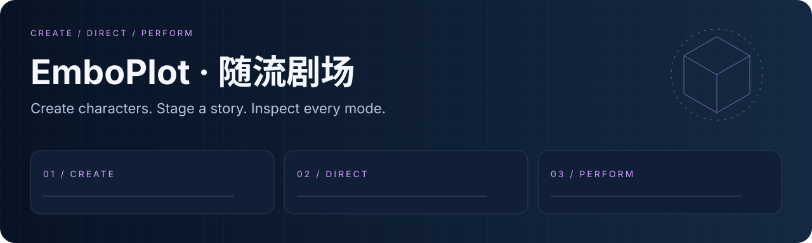
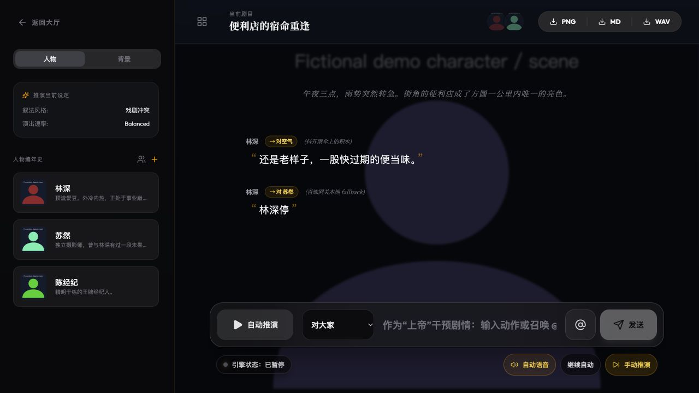

<div align="center">
  
  <h1>EmboPlot · 随流剧场</h1>
  <p><strong>创建角色，编排故事，让多角色互动可检查。</strong></p>
  <p><a href="LICENSE"></a> <a href="docs/readme/validation.md"></a></p>
  <p><a href="#overview">项目亮点</a> · <a href="#quick-start">快速开始</a> · <a href="#workflow">工作流</a> · <a href="#validation">验证</a> · <a href="#documentation">文档</a></p>
  <p><a href="README.en.md">English</a> · <a href="README.md">简体中文</a></p>
</div>

---

<a id="overview"></a>
## 项目亮点

基于 React、Go API、MongoDB 工作区和模型网关的多角色互动剧场。本地示例采用原创抽象 SVG 图片。

| 能力 | 内容 |
| :--- | :--- |
| **故事工作区** | 角色、背景、房间与剧本导出。 |
| **账户 API** | HttpOnly 会话与用户独立 MongoDB 工作区。 |
| **模型网关** | 百炼适配器与确定性开发 fallback。 |

### 本地演示



*本轮本机截图；示例数据、回放与 fallback 模式见下方说明。*

<a id="quick-start"></a>
## 快速开始

```bash
git clone https://github.com/eust-w/EmboPlot.git
cd EmboPlot
npm ci
cp .env.example .env
# Set a random AUTH_JWT_SECRET in .env.
# Start MongoDB locally, or set MONGODB_URI to your own instance.
npm run backend:dev
# In another terminal:
npm run dev
```

<a id="workflow"></a>
## 工作流

```text
CREATE → DIRECT → PERFORM
```

```bash
npm run backend:test
npm run lint
npm run build
```

<a id="validation"></a>
## 验证

```bash
npm run backend:test
npm run lint
npm run build
```

运行环境与已执行结果见 [validation notes](docs/readme/validation.md).

| 项目 | 当前边界 |
| :--- | :--- |
| 模型模式 | 未配置 DASHSCOPE_API_KEY 时后端使用本地 fallback；API 不可用时前端可能使用演示数据。 |
| 部署 | 部署需要随机 JWT secret、正确 ALLOWED_ORIGIN 和 HTTPS 安全 Cookie。 |
| 支付 | 支付适配器需商户配置，本轮不声明真实支付验收。 |

<a id="documentation"></a>
## 文档

- [Original demo assets / 原创示例](public/demo/README.md)
- [Backend / 后端](backend/)
- [Model gateway / 模型网关](backend/internal/modelgateway/)

## 许可证与来源

原创代码和新增演示资源采用 [Apache-2.0](LICENSE). 第三方代码、模型、数据和外部资源保留各自许可，详见 [THIRD_PARTY_NOTICES.md](THIRD_PARTY_NOTICES.md).
