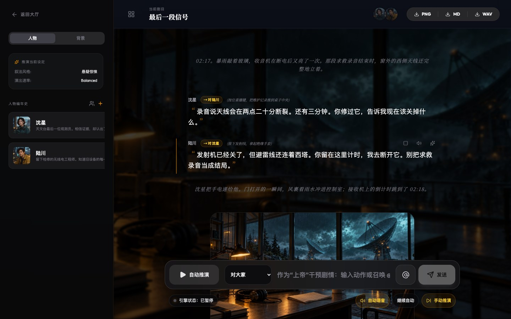
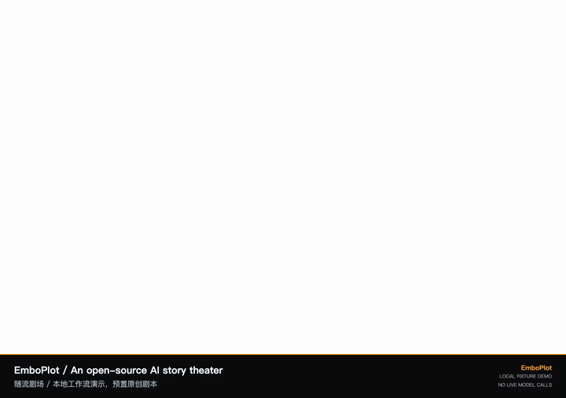
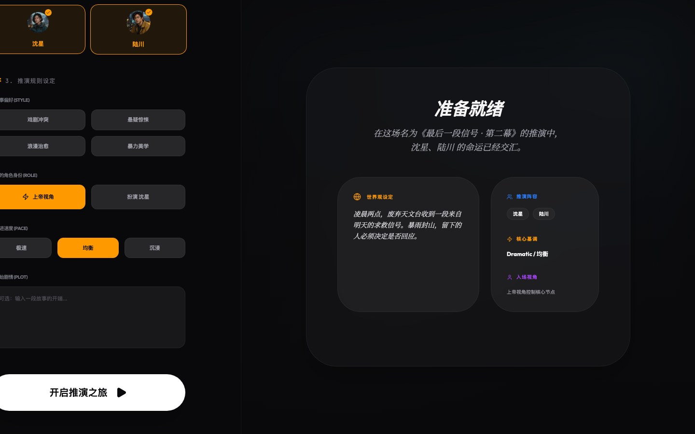
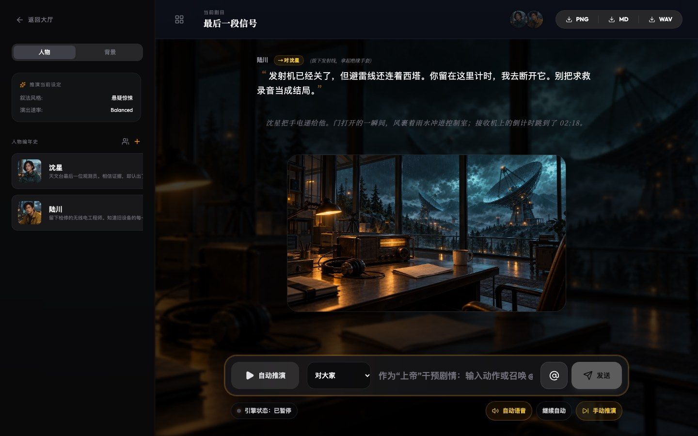
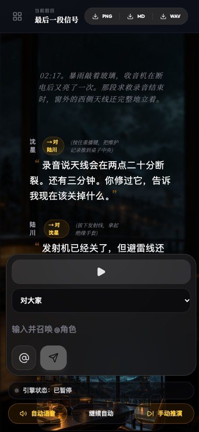
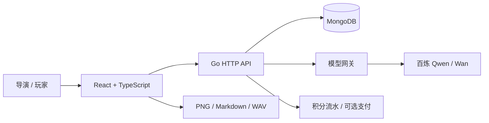

<div align="center">

# EmboPlot · 随流剧场

**给角色一个世界，让故事在你面前发生。**

开源 AI 互动剧场：多角色推演、导演干预、场景绘制与语音演播。

[](https://github.com/eust-w/EmboPlot/actions/workflows/ci.yml)
[](LICENSE)
[](package.json)
[](backend/go.mod)

**简体中文** · [English](README.en.md)

[观看演示](#观看演示) · [快速开始](#快速开始) · [架构](docs/architecture.md) · [参与贡献](CONTRIBUTING.md)

</div>



> 不只是与一个角色聊天。你可以搭建世界、安排阵容，作为导演改变事件，也可以进入故事扮演其中一人。每场演出的文字、图片和音频引用保存在同一条时间线里。

## 观看演示

[](https://github.com/eust-w/EmboPlot/releases/download/v0.1.0-alpha.1/emboplot-walkthrough.mp4)

**[观看 / 下载完整 MP4](https://github.com/eust-w/EmboPlot/releases/download/v0.1.0-alpha.1/emboplot-walkthrough.mp4)** · [示例剧本](docs/examples/the-last-signal.md) · [录制方法与素材说明](docs/showcase.md)

视频为本地浏览器真实操作，使用独立测试账号、原创预置剧本及 AI 辅助创作的示例插画；不是实时模型生成展示，也不包含真实用户数据。视频无配音，附中英字幕；不以此证明 TTS 或支付已验收。

## 你可以做什么

| 从一个想法到一场演出 | 已有能力 |
| --- | --- |
| **创造角色与世界** | 提示词起草人物卡和故事背景；独立性格、记忆字段与音色；生成头像/封面并参考图微调 |
| **编排你的剧场** | 选择故事、阵容、节奏和入场视角；创建、编辑、复制和删除剧场 |
| **让故事继续** | 自动推演、暂停/继续与手动推进；`@` 召唤角色；区分对某人、对大家、自言自语和对空气 |
| **看到并听到剧情** | 旁白与人物对白交错；选中多句生成场景图；角色语音顺序播放并预取缓存 |
| **积累创作资产** | 人物卡与背景发布/下线；公开内容冻结；从市场免费获取副本到创作中心 |
| **带走作品** | 导出 PNG 长图、Markdown 剧本、完整 WAV 音频 |
| **管理账户与消耗** | 邮箱密码登录、头像上传/生成、剧情币余额与扣费流水；可选虎皮椒充值接入 |

### 角色不是一段临时提示词


角色有独立设定、记忆字段与音色。故事背景、在场阵容和最近剧情共同进入下一轮提示词，不靠一个全局角色反复接话。

### 先搭舞台，再决定如何入场



### 剧本不止有台词

<table>
  <tr>
    <td width="74%"></td>
    <td width="26%"></td>
  </tr>
</table>

旁白交代环境与动作，对白注明对象，场景图挂在对应剧情下。桌面侧栏和移动端抽屉共用同一套工作区。

## 快速开始

准备 **Node.js 22.12+、Go 1.24+、MongoDB 7+**。以下命令从仓库根目录执行；先启动本地 MongoDB，默认地址为 `mongodb://localhost:27017`。

```bash
git clone https://github.com/eust-w/EmboPlot.git
cd EmboPlot
npm ci
cp .env.example .env
openssl rand -hex 32
```

将生成的随机值填入 `.env` 的 `AUTH_JWT_SECRET`，按需调整 MongoDB 地址。然后打开两个终端：

```bash
# 终端 1：Go API，默认 :8080
npm run backend:dev
```

```bash
# 终端 2：前端，默认 :3000
npm run dev -- --host 127.0.0.1
```

打开 **[localhost:3000](http://localhost:3000)**，在页面注册自己的账号。无需导入生产数据库，也没有预置通用密码。

- **先体验工作流**：不填 `DASHSCOPE_API_KEY` 可使用本地 fallback。它不是 AI：文字为确定性占位，语音为提示音，图像生成会报未配置。
- **启用真实 AI**：仅在后端 `.env` 填入自己的百炼 `DASHSCOPE_API_KEY`。模型调用可能产生供应商费用，应用内剧情币另行记账。
- **遇到端口占用、模型权限或 Cookie 问题**：见 [完整启动与排障](docs/getting-started.md)。

## 技术结构



| 目录 | 职责 |
| --- | --- |
| [`src/components`](src/components) | 大厅、剧场、编排、创作中心、市场与账户 |
| [`backend/internal/api`](backend/internal/api) | 会话、资源、推演、媒体、扣费与导出接口 |
| [`backend/internal/modelgateway`](backend/internal/modelgateway) | 百炼接入、上下文构建、重复检查及开发 fallback |
| [`backend/internal/store`](backend/internal/store) | MongoDB 持久化与测试用内存实现 |
| [`deploy`](deploy) / [`scripts`](scripts) | Nginx 模板、发布工具与演示录制 |

进一步阅读：[模型与上下文机制](docs/architecture.md) · [非 Docker 部署](docs/deployment.md) · [验证记录](docs/readme/validation.md)

## 当前边界

这是 **alpha 阶段**的创作工具，不是已完成安全审计的生产平台。

- 上下文目前是最近 **24 条**剧情、最近 **8 条**因果摘录，加世界观、角色设定与记忆字段；不是无限记忆，也不保证文学逻辑永不出错。
- 媒体引用会持久化，但供应商签名链接可能过期；长期保存需要自行归档到授权对象存储。
- 部分文字/语音接口在上游失败时会降级。真实模型质量、云端费用、支付回调需独立验收。
- UI 目前以中文为主。公开注册、反滥用、长期媒体存储等生产加固见 [安全说明](SECURITY.md)。

## 一起完善

欢迎从可访问性、英文 UI、长篇剧情记忆、媒体归档和端到端测试入手。请先阅读 [贡献指南](CONTRIBUTING.md)，再提交 [Bug](https://github.com/eust-w/EmboPlot/issues/new?template=bug_report.yml) 或 [功能建议](https://github.com/eust-w/EmboPlot/issues/new?template=feature_request.yml)。如果这个项目对你有帮助，欢迎 Star，也欢迎分享你的原创剧场。

**许可证**：[Apache-2.0](LICENSE)。第三方依赖、导入素材与模型服务仍遵循各自条款，详见 [第三方声明](THIRD_PARTY_NOTICES.md) 与 [素材来源](docs/media/README.md)。
