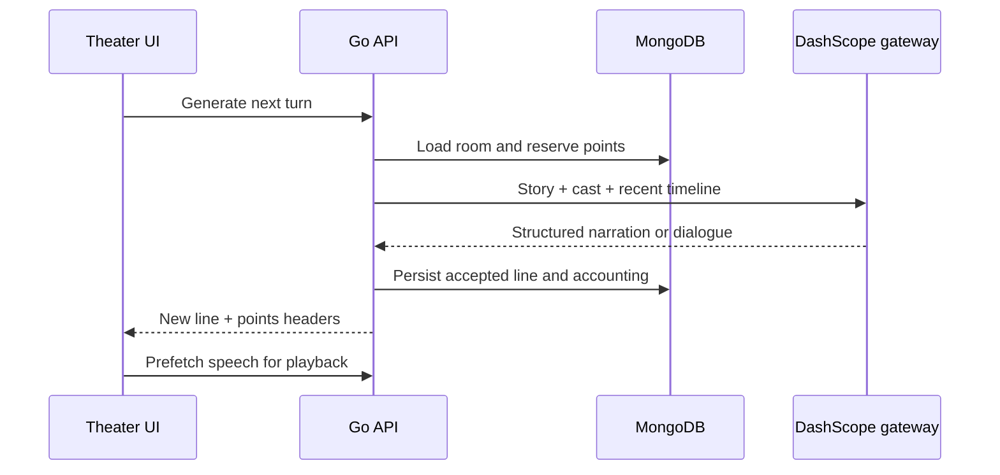

# Architecture and model behavior

## Request path

React views call `src/services/api.ts`. A standard-library Go HTTP server authenticates the session, scopes resource operations to the user, and delegates persistence to the store. Model operations go through `modelgateway`; credentials never belong in the frontend.

## Domain objects

- **Character:** background, personality, memory field, voice, creator and publication state.
- **Story setting:** world description, longer setting text, cover, tags and publication state.
- **Room:** selected world, cast snapshot, game settings and timeline.
- **Script line:** narration/director, character or user input; optional recipient, action, image URL and audio URL.
- **Account:** password hash/session, profile, points, transactions and recharge orders.

Published character/story content is frozen. Unlisting removes market visibility but does not unfreeze the published version. Acquired assets become separate copies in the recipient's library. Public assets must be unlisted before deletion.

## What continuity means today

Source: [`prompts.go`](../backend/internal/modelgateway/prompts.go) and [`dedupe.go`](../backend/internal/modelgateway/dedupe.go).

1. Include the current story and active cast, each with description, personality and memory.
2. Include the latest **24** timeline entries, not the entire historical script.
3. Extract up to **8** recent continuity facts, truncated to 90 runes each.
4. Identify silent cast members, recent text to avoid repeating, and when narration should follow dialogue/user intervention.
5. Ask for structured output with a speaker and `character`, `everyone`, `self` or `air` recipient.
6. Validate/normalize the result and check recent duplicate content before storage.

This is prompt-based continuity with bounded history, not a world simulator or infinite memory. Character `memory` is a stored field; an embedding endpoint does not imply a complete retrieval-augmented memory system. Long-form summarization and memory retrieval remain useful future work.

## Configured model defaults

These are code defaults, not a promise of availability or pricing in every account/region.

| Capability | Environment setting | Default |
| --- | --- | --- |
| Dialogue, narration, drafts | `DASHSCOPE_CHAT_MODEL` | `qwen-plus` |
| Character extraction | `DASHSCOPE_PARSE_MODEL` | `qwen-plus` |
| Text-to-image | `DASHSCOPE_IMAGE_MODEL` | `wan2.6-t2i` |
| Reference-image edit | `DASHSCOPE_IMAGE_EDIT_MODEL` | `wan2.6-image` |
| Speech synthesis | `DASHSCOPE_TTS_MODEL` | `qwen3-tts-flash` |
| Speech recognition | `DASHSCOPE_ASR_MODEL` | `qwen3-asr-flash` |
| Vision analysis | `DASHSCOPE_VISION_MODEL` | `qwen3-vl-plus` |
| Embeddings | `DASHSCOPE_EMBEDDING_MODEL` | `text-embedding-v3` |
| Moderation helper | `DASHSCOPE_MODERATION_MODEL` | `qwen-plus` |

The current gateway uses Alibaba Cloud DashScope. The UI exposes the main creative workflows; not every gateway capability has a dedicated UI. See [fallback behavior](getting-started.md#model-modes) before evaluating output.

## Points and payments

The server reserves points before a model operation and attempts a credit on failure. Successful responses expose balance/charge headers; the profile reads transaction history. Point prices are application rules, **not** the provider's currency invoice.

Current rules in [`billing.go`](../backend/internal/api/billing.go): script turn 8, character parsing 15, character/story draft 12, image generation 30, image edit 35, TTS 2 per 80 runes, ASR 10, embedding 1 per nonempty text, moderation 1 and vision 12. WAV export charges for speech that needs synthesis, not cached lines. Review these rules and refund behavior before running a paid service.

Hupijiao is optional. Settlement, callbacks, duplicate delivery, reconciliation and refunds need merchant-specific acceptance. Local tests and recorded UI are not evidence of a real payment.

## Persistence and media

MongoDB stores user-scoped records and timeline references. The theater requests speech, prefetches it and plays it sequentially. WAV export assembles compatible audio segments; it is not a general media transcoder.

Images/audio are often external provider URLs. A saved URL can expire; long-term preservation needs a storage layer. Treat imported URLs/uploads as untrusted and restrict outbound-network access in production. See [SECURITY](../SECURITY.md).
