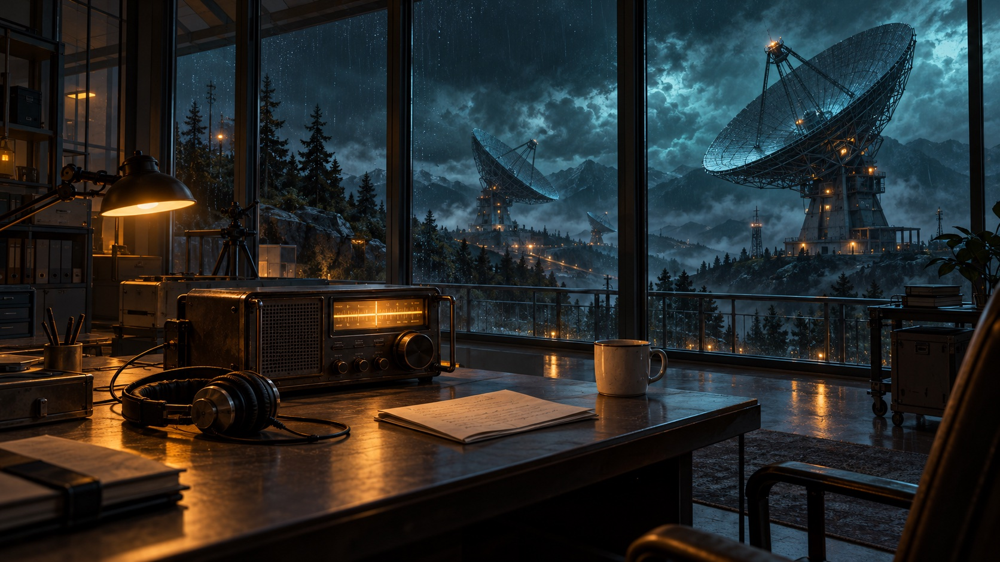

# 最后一段信号 / The Last Signal

> Original prewritten showcase scene. This is a fixture, not live model output.

**Setting:** A remote observatory on its final night of operation. A radio receives a warning from three minutes in the future.

**Cast:** 沈星 (Shen Xing), night-shift astronomer; 陆川 (Lu Chuan), radio engineer.

## 01 / 接收

*旁白 / Narration*

02:17。暴雨敲着玻璃，收音机在断电后又亮了一次。那段求救录音结束时，窗外的西侧天线还完整地立着。

*02:17. Rain drums against the glass. The radio lights up once more after losing power. When the distress recording ends, the western antenna is still standing.*

## 02 / 决定

**沈星 → 陆川**

*按住重播键，把维护记录推到桌子中央。*

> 录音说天线会在两点二十分断裂。还有三分钟。你修过它，告诉我现在该关掉什么。

*Shen Xing holds the replay button and slides the maintenance log across the desk. "The recording says the antenna breaks at 02:20. Three minutes. You repaired it. Tell me what to shut down."*

**陆川 → 沈星**

*拔下发射线，拿起绝缘手套。*

> 发射机已经关了，但避雷线还连着西塔。你留在这里计时，我去断开它。别把求救录音当成结局。

*Lu Chuan disconnects the transmitter cable and picks up his insulated gloves. "The transmitter is off, but the lightning conductor still runs to the west tower. Stay here and keep time. I'll disconnect it. That recording isn't the ending."*

## 03 / 出发

*旁白 / Narration*

沈星把手电递给他。门打开的一瞬间，风裹着雨水冲进控制室；接收机上的倒计时跳到了 02:18。

*Shen Xing hands him the flashlight. Wind drives rain into the control room as he opens the door. The receiver's clock advances to 02:18.*

Continue the scene in your own local theater. The [recording fixture](../../scripts/showcase/fixture.mjs) contains the corresponding structured characters, world and timeline entries.
